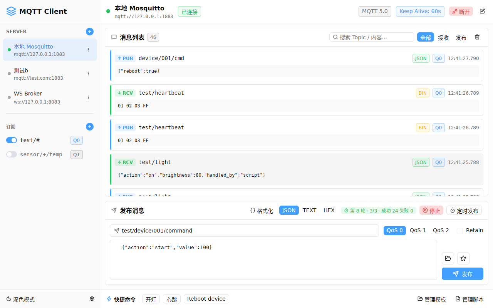
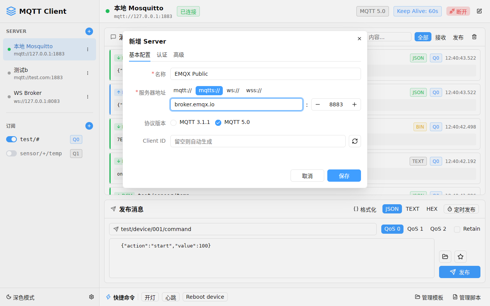
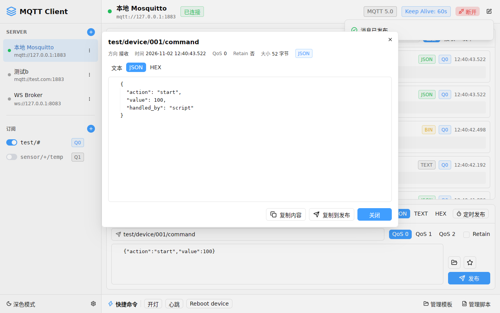
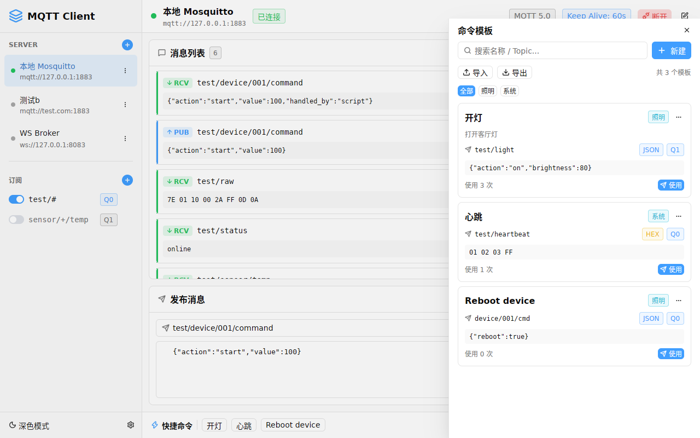
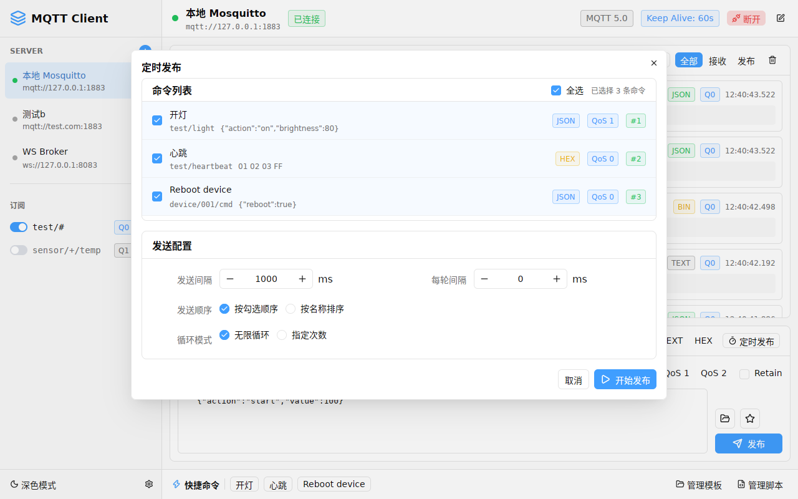
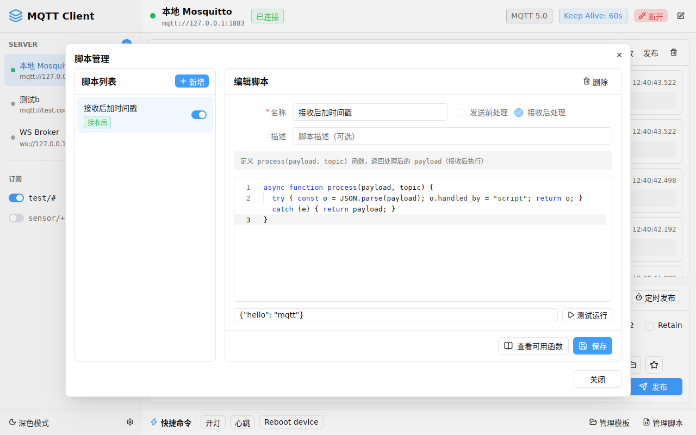

# Mini MQTT Client

一款轻量级、美观的 MQTT 调试客户端，使用 **Rust + [GPUI Kit](https://gpui-kit.com)** 构建的原生桌面应用（GPU 渲染，无 WebView），支持 Windows、macOS 和 Linux。

> v2.0 起项目由 Tauri 2 + Vue 3 完整重写为纯 Rust 实现，原有数据可直接沿用，详见 [数据兼容](#数据兼容)。



## 功能特性

### MQTT 连接管理
- 多服务器配置管理（新增 / 编辑 / 复制 / 删除）
- 支持 **MQTT 3.1.1 和 5.0** 协议
- 支持 `mqtt://`、`mqtts://`（TLS/SSL）、`ws://`、`wss://` 四种传输方式
- TLS 支持自定义 CA 证书与客户端双向认证（PEM），不填 CA 时使用系统根证书
- 多个服务器可同时保持连接，实时连接状态显示
- 连接成功后自动订阅已启用的 Topic
- Keep Alive / Clean Session 配置，Client ID 可自动生成



### 消息发布与订阅
- 多 Topic 订阅，支持通配符 `+` / `#`（带格式校验），可单独启用 / 停用
- QoS 0/1/2、Retain 消息
- 发布格式 JSON / TEXT / HEX，JSON 一键格式化
- 消息列表：实时滚动、虚拟列表（每个服务器保留最近 1000 条）、按方向过滤、关键词搜索
- 自动识别 JSON / TEXT / BIN，消息详情支持文本、JSON 美化、HEX Dump 三种视图
- 一键复制内容或复制到发布面板



### 命令模板
- 保存常用命令为模板，支持分类、搜索
- 底部快捷命令栏按使用频率展示常用模板
- 模板导入 / 导出（JSON，与旧版格式兼容）



### 定时发布
- 选择多条模板循环发送，可按勾选顺序或名称排序
- 发送间隔 / 每轮间隔可配置，支持无限循环或指定轮数
- 可转入后台运行，发布面板实时显示进度并可随时停止



### 预处理脚本
- 内置 JavaScript 引擎（[Boa](https://boajs.dev/)，纯 Rust 实现），支持 `async/await`
- 发送前处理（如加密、封包）与接收后处理（如解密、解析）
- 内置加密工具库：AES-GCM / AES-CBC、SHA-1 / SHA-256 / MD5、HMAC-SHA256、CRC32、Base64 / Hex 等
- 代码编辑器带语法高亮，可直接 **测试运行** 并查看 `console.log` 输出
- 死循环保护：超出运行限制的脚本会被中止而不会卡住界面



### 其他
- 浅色 / 深色 / 跟随系统主题
- 自定义数据存储位置（可迁移现有数据）
- 错误日志记录与查看（含崩溃信息）
- 消息时间精确到毫秒

## 安装

前往 [Releases](../../releases) 页面下载对应平台的压缩包：

| 平台 | 文件 |
|------|------|
| Windows | `mini-mqtt-client-windows-x64.zip`（解压即用） |
| macOS | `mini-mqtt-client-macos-universal.zip`（`Mini MQTT Client.app`） |
| Linux | `mini-mqtt-client-linux-x64.tar.gz` |

## 从源码构建

需要 Rust 1.92+（推荐使用 [rustup](https://rustup.rs) 安装最新 stable）。

```bash
git clone https://github.com/dreamlonglll/mini-mqtt-client
cd mini-mqtt-client

# 开发运行
cargo run

# 构建发布版本（产物位于 target/release/）
cargo build --release
```

Linux 需要先安装以下系统依赖（以 Ubuntu/Debian 为例）：

```bash
sudo apt-get install -y libxkbcommon-dev libxkbcommon-x11-dev libwayland-dev libvulkan-dev libx11-xcb-dev libxcb1-dev libfontconfig1-dev libfreetype6-dev
```

### 测试

```bash
# 单元测试（存储、协议校验、加密函数、脚本引擎等）
cargo test

# 连接真实 Broker 的集成测试（需要本地 1883 TCP 与 8083 WebSocket 监听）
cargo test -- --ignored
```

## 数据兼容

新版与旧版（Tauri）使用相同的数据目录和文件格式，升级后服务器、订阅、模板、脚本会自动加载：

| 平台 | 数据目录 |
|------|----------|
| Windows | `%APPDATA%\com.minimqtt.client` |
| macOS | `~/Library/Application Support/com.minimqtt.client` |
| Linux | `~/.local/share/com.minimqtt.client` |

目录下包含 `data.yaml`（数据）、`config.yaml`（自定义数据路径、主题）和 `logs/`（错误日志）。也可通过环境变量 `MINI_MQTT_DATA_DIR` 指定其他目录。

与旧版相比的行为变化：
- 协议版本 / TLS / WebSocket 设置现在真正生效（旧版后端始终以 MQTT 3.1.1 + TCP 连接）
- HEX 格式的模板在定时发布时按字节发送（旧版会把 HEX 字符串当文本发送）
- `aesCbcEncrypt/Decrypt` 使用标准的单层 PKCS#7 填充，可与其他系统互通（旧版重复填充）
- `md5` / `crc32` 按 UTF-8 字节计算，结果与常见工具一致
- 接收后脚本未修改内容时保留原始字节，二进制消息不再被 UTF-8 转换破坏
- 消息列表为内存中的实时视图，不再把每条发布记录写入 `data.yaml`

## 技术栈

| 层级 | 技术 |
|------|------|
| UI 框架 | [GPUI](https://www.gpui.rs) + [GPUI Kit](https://gpui-kit.com)（gpui-component 组件库） |
| MQTT | [rumqttc](https://github.com/bytebeamio/rumqtt)（tokio，rustls） |
| 脚本引擎 | [Boa](https://github.com/boa-dev/boa) |
| 加密 | RustCrypto（aes-gcm、cbc、sha2、hmac 等） |
| 数据存储 | YAML（serde_yaml） |

## 目录结构

```
mini-mqtt-client/
├── src/
│   ├── main.rs              # 入口：初始化 GPUI Kit、打开窗口
│   ├── assets.rs            # 图标资源（Lucide）
│   ├── state.rs             # AppState：连接状态、消息流、业务操作
│   ├── backend/             # 与 UI 无关的逻辑
│   │   ├── models.rs        # 数据模型（与旧版 data.yaml 兼容）
│   │   ├── storage.rs       # YAML 存储
│   │   ├── config.rs        # 数据目录、config.yaml
│   │   ├── logger.rs        # 错误日志
│   │   ├── mqtt.rs          # MQTT 连接管理（v3.1.1/v5、TLS、WS）
│   │   ├── payload.rs       # 格式识别、HEX、JSON
│   │   ├── topic.rs         # Topic 校验
│   │   ├── errors.rs        # 友好的错误提示
│   │   └── script/          # JS 脚本引擎与 crypto API
│   └── ui/                  # GPUI 视图与对话框
├── assets/app-icon/         # 应用图标
├── docs/                    # 文档与截图
└── .github/workflows/       # CI / Release
```

## 许可证

MIT License
